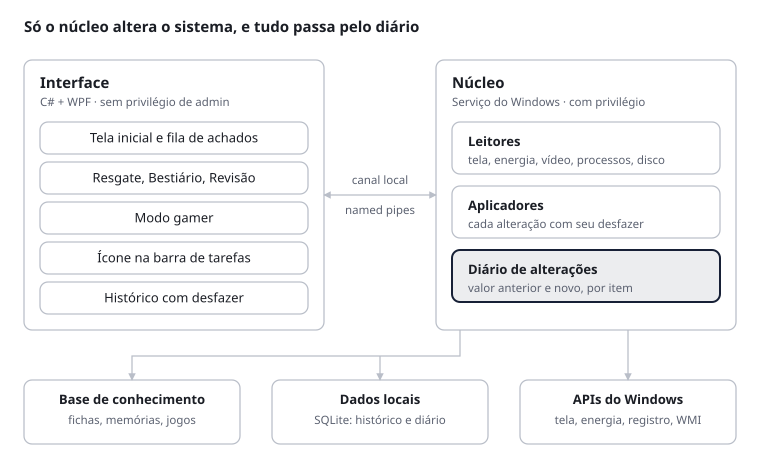
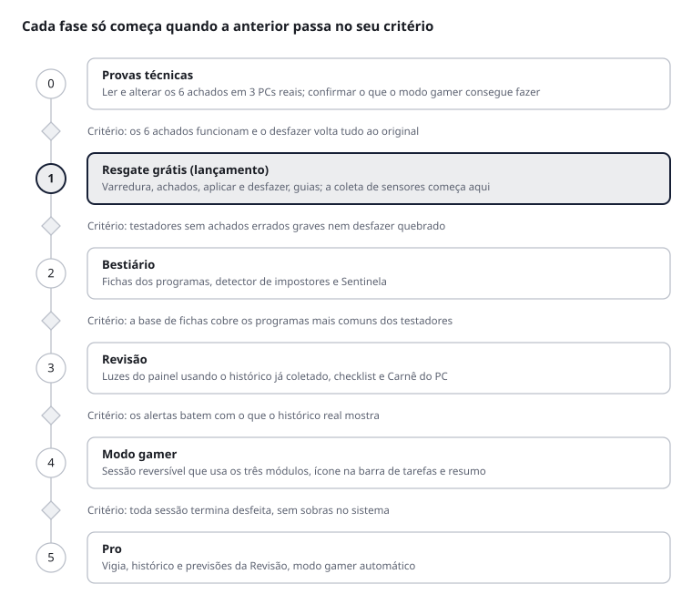

# Zenith: plano do produto

24 de outubro de 2026 · Versão viva (editável): [Claude Doc](https://claude.ai/artifact/RBdqr36znjSTwhAsr96SjT)

## Visão

O Zenith é um app para Windows que explica o PC de qualquer pessoa em linguagem simples e conserta o que é seguro consertar. A frase-guia é **seu PC, explicado**.

O público é amplo: quem joga e quem só usa o computador, sem precisar entender de hardware. O lançamento começa pelo Brasil.

O diferencial não é juntar funções, como fazem os gerenciadores de PC tradicionais. É o ângulo: mostrar o que a pessoa pagou e não usa, explicar o que roda no PC e acompanhar o desgaste ao longo do tempo.

Mockups, modo gamer e marca: pasta `design/` deste pacote e o [canvas do projeto](https://claude.ai/artifact/Np7wUJpKgx39LfLnrgRqLk).

## Princípios

Toda decisão de produto passa por esta regra: **ler tudo, consertar o que é seguro, explicar o resto.**

1. **Tudo é reversível.** Cada alteração fica registrada com o valor anterior e tem botão de desfazer.
2. **Nunca afirmar sem evidência.** Cada achado mostra de onde veio; ganhos de desempenho só com medição antes e depois.
3. **Sistema e antivírus são intocáveis.** Nenhuma função pausa, fecha ou altera programas do Windows ou de proteção.
4. **Segurança nunca é paga.** Detecção de programas suspeitos e avisos críticos ficam no plano grátis.
5. **Linguagem de quem explica.** Sem jargão; o termo técnico aparece entre parênteses, quando ajuda.
6. **Sem promessa vaga.** Nada de "deixe seu PC mais rápido"; cada ganho é nomeado e comprovado.

## Os três módulos

Cada módulo responde a uma pergunta que a pessoa comum não sabe responder sobre o próprio PC.

| Módulo | Pergunta que responde | Conserta sozinho | Vira guia passo a passo |
| --- | --- | --- | --- |
| Resgate | O que eu paguei e não estou usando? | Taxa do monitor, HDR, plano de energia, placa de vídeo usada por cada jogo | Perfil de memória na BIOS, cabo do monitor no lugar certo |
| Bestiário | O que está rodando no meu PC? | Impedir programas de iniciar com o Windows, isolar suspeitos | Remover um programa indesejado |
| Revisão | Como meu PC está envelhecendo? | Limpar arquivos temporários, refazer a medição depois de uma limpeza | Limpeza física, troca de pasta térmica |

Funções que acompanham cada módulo:

- **Resgate:** cada achado mostra o ganho "antes → depois" (ex.: 60 → 144 Hz); o **Comprovante** mede o efeito; o **Vigia** avisa quando uma atualização desfaz um resgate.
- **Bestiário:** cada programa vira uma ficha com o que é, o que faz, nível de ameaça e custo (RAM, CPU, rede, inicialização). O detector de impostores marca nomes que imitam processos do Windows, pastas estranhas e falta de assinatura digital. A **Sentinela** avisa quando chega um programa novo e de onde ele veio.
- **Revisão:** luzes de painel (temperatura, SSD, espaço, ventoinhas, drivers), previsões (disco cheio, desgaste do SSD, bateria) e o **Carnê do PC**, com o histórico de manutenções e o efeito de cada uma.

A tela inicial junta os três numa fila única em ordem de importância: segurança primeiro, depois hardware parado, depois manutenção.

## Modo gamer

O modo gamer não é um quarto módulo: é uma **sessão reversível** em que os três trabalham juntos enquanto você joga.

- **Como liga:** sozinho quando um jogo reconhecido abre, ou só quando você mandar. A escolha é do usuário, e o ícone na barra de tarefas liga e desliga em qualquer caso.
- **Silêncio:** notificações e Windows Update pausados até o fim da sessão. As notificações ficam guardadas para o resumo.
- **Programas pausados (Bestiário):** os classificados como dispensáveis, mais os extras que o usuário marcar. Nunca são pausados programas do sistema, o antivírus e os protegidos pelo usuário, como o Discord.
- **Energia e tela (Resgate):** plano de desempenho, monitor na taxa máxima e HDR opcional nos jogos compatíveis.
- **Vigia de temperatura (Revisão):** aviso discreto acima dos limites definidos pelo usuário (sugestão inicial: 85 °C no processador, 83 °C na placa de vídeo).
- **Na barra de tarefas:** o ponto do topo do símbolo fica roxo. Ao passar o mouse, mostra temperatura e uso de processador e placa de vídeo, além do tempo de sessão.
- **Ao sair:** tudo é desfeito e aparece um resumo com o que voltou ao normal, como o PC se comportou e uma ponte para a Revisão quando algo merece atenção.

## Identidade

A marca é **Zenith**, com o símbolo **Ascensão**: pontos que sobem e crescem até o topo, onde o maior ponto também funciona como indicador de status. Arquivos em `design/marca/` e `design/tokens/`.

| Elemento | Decisão |
| --- | --- |
| Nome | Zenith, como nome de projeto até a pesquisa de marca no INPI |
| Símbolo | Ascensão: 4 pontos em tamanho grande; 3 pontos no ícone e na barra de tarefas, mais encorpados em 16 px |
| Cor da marca | Azul-noite #172036, Luz #F4F1EA (pontos sobre fundo escuro), Névoa #F2F3F5 (fundo do app) |
| Cores de status | Roxo #6B5B8E (modo gamer ativo), Âmbar #B07F2E (alerta de temperatura) |
| Cores dos módulos | Resgate #4E7D6C, Bestiário #55628F, Revisão #3F6E86 |
| Comportamento | O ponto do topo muda de cor conforme o status: azul-noite em repouso, roxo ativo, âmbar pulsando em alerta |
| Abertura do app | Os pontos surgem um a um, subindo; o nome aparece em seguida |
| Tipografia | Manrope |
| Visual | Premium e calmo, sem neon; paletas limpas e animações suaves de entrada |
| Tom de voz | Direto e sem jargão, como alguém do suporte que explica em vez de mandar |

## MVP: Resgate primeiro

A primeira versão é o Resgate sozinho: varredura em 1 clique, achados explicados, aplicar e desfazer, e guias para o que exige BIOS ou hardware. Ele entrega valor nos primeiros 30 segundos e gera a frase que as pessoas compartilham.

| Achado | Ação na v1 | Observação |
| --- | --- | --- |
| Monitor abaixo da taxa máxima (ex.: 60 de 144 Hz) | Aplica com 1 clique | Compara o modo atual com os modos que o monitor suporta |
| HDR disponível e desligado | Liga com teste de 15 s | Só aparece em monitores com suporte |
| Plano de energia limitando o processador | Aplica com 1 clique | Mais relevante em PCs de mesa |
| Jogo rodando na placa de vídeo integrada | Define a placa dedicada para aquele jogo | Notebooks e PCs com duas placas |
| Monitor ligado no vídeo da placa-mãe, com placa dedicada instalada | Guia com foto de onde ligar | Erro comum em PCs de mesa |
| Memória abaixo da velocidade de fábrica | Guia na BIOS | Detecção limitada na v1; ver Riscos |

Também entram na v1:

- **Diário de alterações**, com desfazer por item e "desfazer tudo".
- **Coleta silenciosa de sensores** desde o primeiro dia, para a Revisão já nascer com histórico quando for lançada.

Ficam fora da v1: Bestiário, Revisão, modo gamer, detecção de cabo limitando o monitor e de G-Sync/FreeSync desligado.

## Arquitetura e tecnologia

Recomendação: **C# + .NET 10 + WPF** na interface e um **serviço do Windows em C#** como núcleo. É a mesma base do inspetor de memória, então o que você aprende num projeto serve no outro.

A interface roda sem privilégio de administrador e só pede ações ao núcleo; o núcleo executa, registra no diário e devolve o resultado.

Por que WPF e não WinUI 3: o visual do Zenith é próprio, não o padrão do Windows 11, então a principal vantagem do WinUI 3 some. O WPF é mais maduro, tem animações sólidas e dá menos trabalho para empacotar; o ícone na barra de tarefas sai com biblioteca pronta.

| Achado do Resgate | Onde o núcleo lê e altera |
| --- | --- |
| Taxa do monitor | API de configuração de tela do Windows |
| HDR | Informações de cor avançada, na mesma API de tela |
| Plano de energia | API de energia do Windows |
| Placa de vídeo por jogo | Configuração gráfica do Windows, a mesma da tela de Configurações |
| Monitor no vídeo integrado | Lista de adaptadores de vídeo e suas saídas (DXGI) |
| Memória abaixo da velocidade | WMI e base de modelos de memória |

## Modelo grátis + Pro

Proposta de regra: **tudo que lê, explica e conserta uma vez é grátis; o Pro paga pelo que trabalha continuamente em segundo plano.** Assim o grátis já resolve o problema e o Pro vende conveniência, nunca segurança.

| Recurso | Plano | Por quê |
| --- | --- | --- |
| Varredura, achados, aplicar, desfazer e guias do Resgate | Grátis | É a porta de entrada e o que gera compartilhamento |
| Fichas do Bestiário, detector de impostores e Sentinela | Grátis | Segurança nunca é paga |
| Luzes do painel da Revisão (estado atual) | Grátis | Mostra o valor do histórico que o Pro oferece |
| Modo gamer ligado na mão, com resumo da sessão | Grátis | Deixa o usuário experimentar o modo completo |
| Vigia (avisa quando um resgate é desfeito) | Pro | Trabalho contínuo em segundo plano |
| Revisão com histórico, previsões e Carnê do PC | Pro | Depende de meses de dados acumulados |
| Modo gamer automático e histórico de sessões | Pro | Conveniência para quem joga com frequência |

Forma de cobrança decidida: assinatura mensal ou licença vitalícia, mais cara. Os valores ainda estão em aberto.

## Roadmap

Seis fases, sem datas: cada uma avança quando passa no seu critério, não pelo calendário.

Como a coleta de sensores começa junto com o Resgate, a Revisão já nasce com meses de histórico.

## Riscos

Os dois riscos que podem parar o projeto são o nome e a desconfiança de antivírus; os outros se resolvem com escopo e testes.

| Risco | Por que importa | Como reduzir |
| --- | --- | --- |
| Conflito do nome | Já existem o [WinZenith](https://alternativeto.net/software/winzenith/), app de manutenção do Windows, e o [Project Zenith](https://www.thurrott.com/?p=341136) da Microsoft, além da marca de eletrônicos Zenith | Pesquisa no INPI (classes 9 e 42) antes de gastar com domínio e logo final; trocar cedo se houver conflito |
| Driver de sensores marcado como ameaça | Em 2025 o Defender passou a sinalizar o driver WinRing0, usado por várias ferramentas de monitoramento ([Neowin](https://www.neowin.net/news/windows-1110-is-flagging-winring0-on-your-pc-monitoring-fan-control-apps-heres-why/)); projetos migraram para o PawnIO, com driver assinado pela Microsoft ([exemplo](https://github.com/seakyy/OmenMon-Reborn/releases/tag/v1.4.0-reborn)) | v1 sem driver próprio, usando só o que o Windows e os fabricantes de placa de vídeo expõem; temperaturas detalhadas entram depois, via PawnIO ou equivalente, com consentimento |
| Antivírus e SmartScreen desconfiarem do app | Um app que altera configurações do sistema parece suspeito | Assinatura de código, distribuição pela Microsoft Store, núcleo pequeno e sem ofuscação |
| Achado errado | Um falso "você está perdendo desempenho" destrói a confiança | Só mostrar achado com evidência; testar em PCs variados; botão "isso está errado" em cada achado |
| Velocidade de fábrica da memória | O Windows informa a velocidade em uso, mas a de fábrica completa (perfil XMP/EXPO) fica no chip da memória | Na v1, consultar o modelo do pente numa base de dados; leitura direta só com o driver de sensores |
| Funções do modo gamer sem caminho oficial | Silenciar notificações e pausar processos podem não ter API oficial simples | Confirmar na fase de provas técnicas; sem API oficial, usar alternativa segura (baixar prioridade em vez de pausar) |
| Concorrência gratuita | Microsoft PC Manager e o Modo de Jogo do Windows já são grátis | Não competir em "limpeza"; vender o ângulo de explicar e provar |
| Escopo grande | Três módulos e um modo gamer é muito para uma pessoa | MVP só com Resgate; cada módulo é uma fase com critério de saída |

## Decisões

O produto, o MVP, o modelo e a marca estão decididos; preço, código aberto e idioma ainda não.

| Tema | Decisão tomada |
| --- | --- |
| Produto | Um app com três módulos (Resgate, Bestiário, Revisão) e um modo gamer que usa os três |
| Otimizador que prova | Fica fora do Zenith e segue como projeto separado |
| Público | Geral, com lançamento pelo Brasil |
| MVP | Resgate |
| Modelo | Grátis com versão Pro paga |
| Marca | Zenith (provisório até o INPI), símbolo Ascensão, azul-noite |
| Modo gamer | Liga sozinho ou na mão; pausa dispensáveis e extras marcados; o mouse sobre o ícone mostra temperatura e uso; resumo ao sair |

Em aberto:

- Preço e forma de cobrança do Pro.
- Código aberto ou fechado.
- Inglês já no lançamento ou depois.
- Aprovação da tecnologia recomendada (seção Arquitetura).
- Resultado da pesquisa de marca no INPI.

## Próximos passos

O primeiro passo é tirar o risco do nome; o segundo, provar que os achados do Resgate funcionam de verdade.

- [ ] Pesquisar "Zenith" no INPI, classes 9 e 42
- [ ] Aprovar a tecnologia recomendada
- [ ] Fase 0: provar os 6 achados do Resgate em pelo menos 3 PCs diferentes (um de mesa com placa dedicada, um notebook com duas placas de vídeo e um com monitor de alta taxa)
- [ ] Definir o formato do diário de alterações e do desfazer
- [ ] Aplicar a marca Ascensão em todas as telas dos mockups
